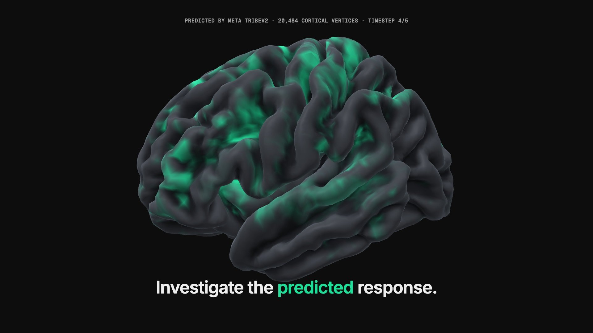
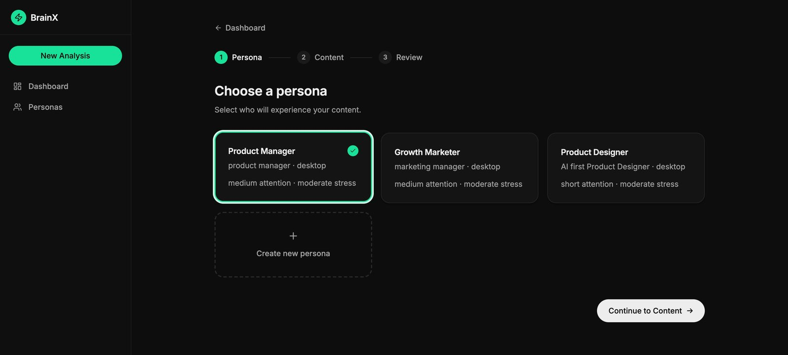
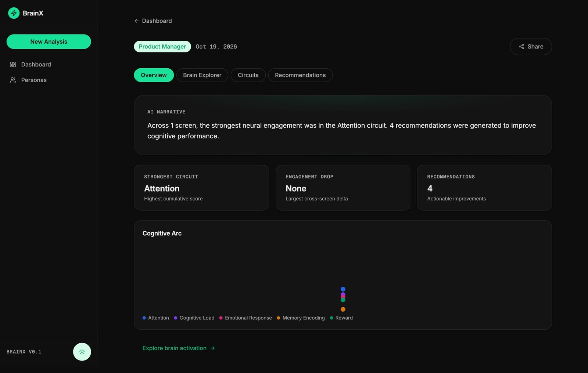
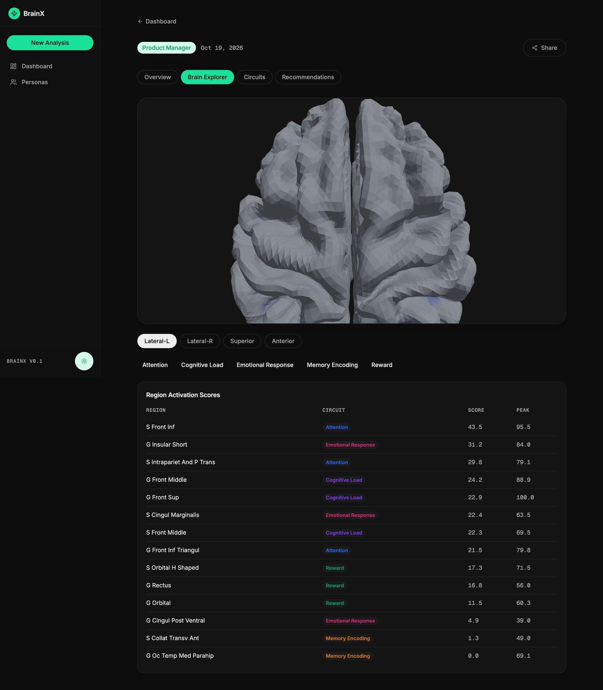
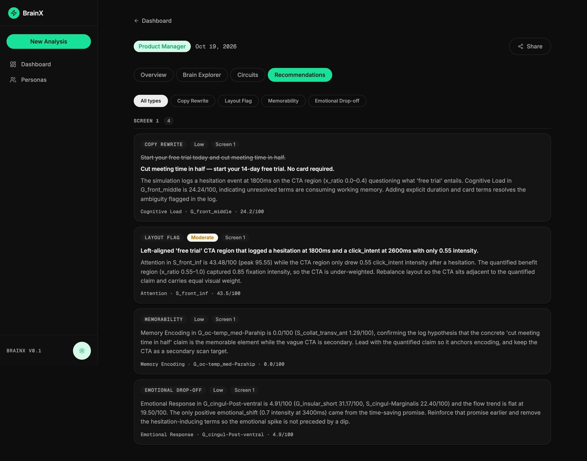

# BrainX

**See how a reader's brain might respond to your copy, before anyone reads it.**

<p align="center">
  <a href="https://akashazad.com/brainx"></a>
</p>

BrainX simulates how a specific persona reads a piece of content, runs Meta's
[TRIBEv2](https://github.com/facebookresearch/tribev2) brain-encoding model over
that simulated read, and turns the predicted cortical response into five
circuit scores: **Attention, Cognitive Load, Emotional Response, Memory
Encoding and Reward**. It then writes copy and layout recommendations that
must cite the brain regions and reader behaviour they are based on.

Watch the launch film and read the case study at
**[akashazad.com/brainx](https://akashazad.com/brainx)**.

> **Research preview.** BrainX outputs are model predictions about a simulated
> reader, not measurements of real people. Read [Honest limits](#honest-limits)
> before drawing conclusions from them.

## Why

Copy testing usually means shipping and waiting for clicks, or asking people
what they think (which is not the same as what they do). Brain-encoding models
like TRIBEv2 predict fMRI responses to naturalistic stimuli. BrainX asks a
narrower question: if a reader like *this* persona read *this* text, which
cortical systems would the model expect to light up, where does the response
drop, and what concrete rewrite addresses it?

## Screenshots

| Choose a persona | Results overview |
| --- | --- |
|  |  |
| **Brain explorer** | **Evidence-grounded recommendations** |
|  |  |

## How it works

`POST /analyze` queues a job. A single asyncio worker drives it through six
stages, and the frontend polls the job as it moves between them.

| # | Stage | What happens | Code |
| - | --- | --- | --- |
| 1 | **Simulation** | DeepSeek role-plays the persona reading the content and returns a structured, per-screen behaviour log (fixations, hesitations, emotional shifts, click intent). | `backend/services/simulation.py` |
| 2 | **Grounding check** | For image content, a vision model (DeepSeek-VL2 on Replicate) checks the simulated narrative against the actual image. Text content passes through. | `backend/services/grounding.py` |
| 3 | **Inference** | Each screen is turned into a stimulus (text is spoken with TTS and transcribed by WhisperX) and run through TRIBEv2, which predicts activity at 20,484 cortical vertices on the fsaverage5 surface. | `backend/services/inference.py` |
| 4 | **ROI aggregation** | Vertices are mapped to Destrieux atlas regions, and regions are grouped into the five circuits. | `backend/services/roi_aggregation.py` |
| 5 | **Processing** | Scores are rescaled to 0-100, and overlays and cross-screen flow continuity are computed. | `backend/services/overlay.py`, `continuity.py` |
| 6 | **Recommendations** | DeepSeek proposes rewrites and layout fixes. Each one is validated against the ROI evidence and the behaviour log, with up to three attempts, and ungrounded advice is rejected. | `backend/services/recommendations.py` |

Results are stored on the job row, and per-screen activations are saved to
disk, so finished sessions replay instantly without re-running inference.
[CLAUDE.md](CLAUDE.md) has a deeper architecture tour, including the queue's
resilience rules.

**Stack:** FastAPI, SQLite (SQLAlchemy + aiosqlite), PyTorch on CPU, Nilearn;
React 19, Vite, TanStack Query, zustand, three.js via react-three-fiber.

## Requirements

- **Python 3.11** and **Node.js 22+** (developed on macOS with Apple Silicon;
  Linux should work but is untested)
- **[uv](https://docs.astral.sh/uv/)**: TRIBEv2 runs WhisperX via `uvx whisperx`
- **libmagic** for upload type detection (`brew install libmagic` or
  `apt install libmagic1`)
- **Disk:** plan for **15-25 GB** in `model_cache/`. The TRIBEv2 checkpoint is
  only about 0.7 GB, but it pulls large feature extractors on first use
  (Llama-3.2-3B about 6.4 GB, w2v-BERT 2.0 about 2.3 GB, V-JEPA 2 about 4 GB for
  video) plus the WhisperX tool environment.
- **RAM:** 16 GB minimum; more is better.
- **API keys** (see below)

### API keys

| Variable | Needed for | Get it |
| --- | --- | --- |
| `DEEPSEEK_API_KEY` | Always: simulation and recommendations. Submissions are rejected with a 422 without it. | [platform.deepseek.com](https://platform.deepseek.com/) |
| `HF_TOKEN` | Downloading TRIBEv2 and its encoders at startup. The account **must have accepted the [Llama 3.2](https://huggingface.co/meta-llama/Llama-3.2-3B) licence**, because TRIBEv2's text pathway uses that gated model. | [huggingface.co/settings/tokens](https://huggingface.co/settings/tokens) |
| `REPLICATE_API_TOKEN` | Image content only (the grounding check). Text-only analyses work without it. | [replicate.com/account/api-tokens](https://replicate.com/account/api-tokens) |

## Setup

```bash
git clone https://github.com/iamakashazad/brainx.git
cd brainx

# 1. Backend environment: Python 3.11 venv, PyTorch, TRIBEv2, requirements.
#    Creates the venv at $BRAINX_VENV (default ~/.venvs/brainx). Set
#    BRAINX_PYTHON if python3.11 is not on your PATH.
./setup_env.sh

# 2. Keys
cp .env.example .env    # then fill in DEEPSEEK_API_KEY, HF_TOKEN, and optionally REPLICATE_API_TOKEN

# 3. Frontend
cd frontend && npm install && cd ..
```

`setup_env.sh` clones TRIBEv2 into `./tribev2` (gitignored) at a pinned
upstream commit and applies [`patches/tribev2.patch`](patches/tribev2.patch).
The patch makes TRIBEv2 practical on CPU: a smaller WhisperX model, silero
VAD instead of pyannote (which breaks on PyTorch 2.6), a retry for flaky
`uvx` cold starts, and an environment fix for the WhisperX subprocess. The
reasoning behind each change is in
[`patches/tribev2-changes.md`](patches/tribev2-changes.md). The script is safe
to re-run.

## Run

Use two terminals, both from the repo root. `$PY` is your venv's Python
(`~/.venvs/brainx/bin/python` by default).

```bash
# Backend on :8000. Loads TRIBEv2 at startup (about a minute once cached;
# the first start also downloads the models).
$PY -m uvicorn backend.main:app --port 8000
```

```bash
# Frontend on :5173
cd frontend && npm run dev
```

Open http://localhost:5173. The pinned **Sample Analysis** card opens a
pre-built result with no inference. For a real run, create a persona, paste a
**single sentence** of copy, and expect a few minutes per screen.
`GET /health` reports any missing keys.

To browse the UI with no backend at all, start the frontend against the
built-in mocks:

```bash
cd frontend && VITE_USE_MSW=1 npm run dev
```

## Honest limits

- **Predictions, not measurements.** TRIBEv2 predicts average fMRI responses
  from a stimulus. BrainX feeds it a *simulated* reading by an LLM-generated
  persona. Nothing here observes a real brain or a real user, so treat scores
  as a structured hypothesis to test, not evidence.
- **Circuit mapping is a simplification.** Grouping atlas regions into five
  named circuits is a coarse, interpretive layer on top of the model output.
- **Slow on CPU.** Each screen takes about 2-3 minutes (TTS, WhisperX,
  then model inference). Use one-sentence content; long multi-screen content
  can exceed the default 3600 s job timeout (`JOB_TIMEOUT_SECONDS`). Keep the
  machine awake during a run, because sleep pauses the server while the job
  timeout keeps counting. MPS is not used because TRIBEv2 stalls on it.
- **Image pathway not live-verified.** Image upload and the Replicate
  grounding check are covered by tests, but have not been verified end to end
  against the live services. The text pathway has.
- **Brain view camera presets are not wired up yet.**
- **Your content leaves your machine.** Content and persona text go to
  DeepSeek, simulated reading text goes to Google's TTS endpoint (via gTTS),
  and uploaded images go to Replicate.
- **Non-commercial.** TRIBEv2 and its weights are CC BY-NC 4.0, so running
  BrainX end to end is limited to non-commercial use. See
  [License](#license).

## Testing

```bash
# Backend: hermetic. Uses dummy keys and a fake TRIBEv2, so no network or GPU.
$PY -m pytest tests/ -q

# Frontend
cd frontend
npx tsc -b --force   # always --force: a stale tsbuildinfo can hide real errors
npx vitest run
```

Live tests are skipped by default. `RUN_LIVE_TRIBEV2=1` /
`RUN_TRIBEV2_INTEGRATION=1` run real TRIBEv2 inference, and
`tests/test_recommendations_blind_eval.py` runs only with a real
`DEEPSEEK_API_KEY` (it calls the live API and can be flaky, so rerun once
before treating a failure as a regression).

## Project layout

```
backend/        FastAPI app: routers, queue worker, pipeline services, ML loader
frontend/       React + Vite app (pages in src/pages, brain view in src/features/results)
tests/          Backend pytest suite
alembic/        Database migrations
patches/        TRIBEv2 patch and change notes
scripts/        Asset bake script for the fsaverage5 brain mesh
.planning/      Build log: phase plans, verification and UAT notes from development
```

## License

- **BrainX source code:** [MIT](LICENSE).
- **TRIBEv2 and its weights:** [CC BY-NC 4.0](https://creativecommons.org/licenses/by-nc/4.0/),
  non-commercial use only. They are not included in this repository; they are
  cloned and downloaded at setup and runtime. `patches/tribev2.patch` is a
  derivative of TRIBEv2 and is CC BY-NC 4.0 as well.
- **Brain mesh and atlas assets** in `frontend/public/brain/` are modified
  FreeSurfer data, under the
  [FreeSurfer Software License](frontend/public/brain/LICENSE-FreeSurfer.txt).

See [NOTICE](NOTICE) for full third-party terms.

## Credits

- [Meta FAIR, TRIBEv2](https://github.com/facebookresearch/tribev2): the brain-encoding model at the core of BrainX
- [DeepSeek](https://www.deepseek.com/): persona simulation and recommendations
- [DeepSeek-VL2 on Replicate](https://replicate.com/deepseek-ai/deepseek-vl2): image grounding check
- [WhisperX](https://github.com/m-bain/whisperX): word-level speech transcription
- [FreeSurfer](https://surfer.nmr.mgh.harvard.edu/) fsaverage5 surface and the Destrieux atlas (Destrieux et al., 2010), loaded with [Nilearn](https://nilearn.github.io/)
- [gTTS](https://github.com/pndurette/gTTS): text-to-speech for the simulated read

Built by [Akash Azad](https://akashazad.com).
